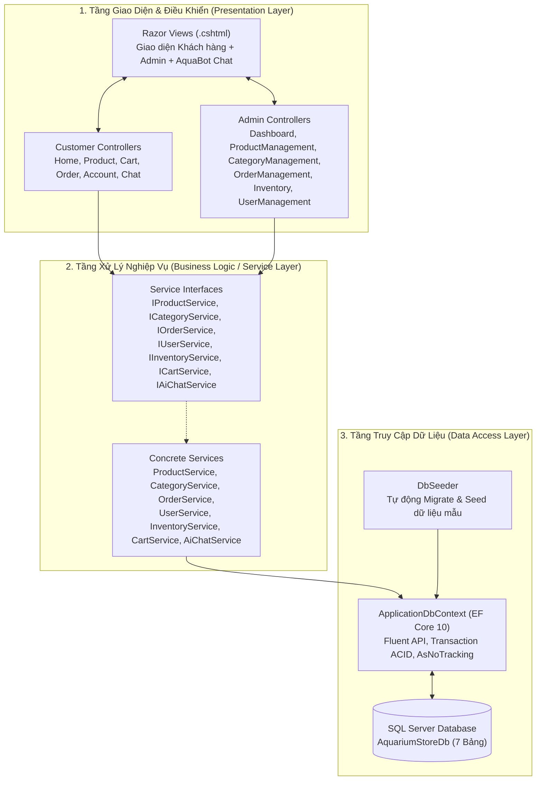
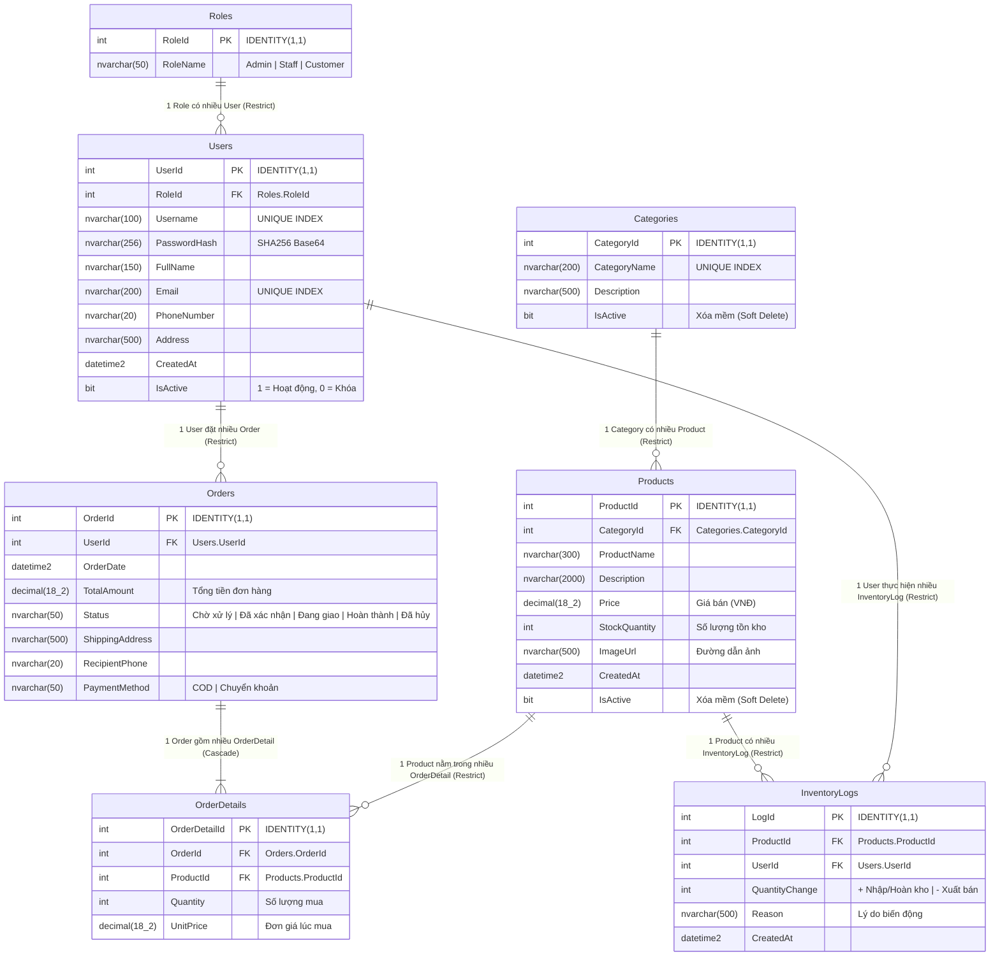
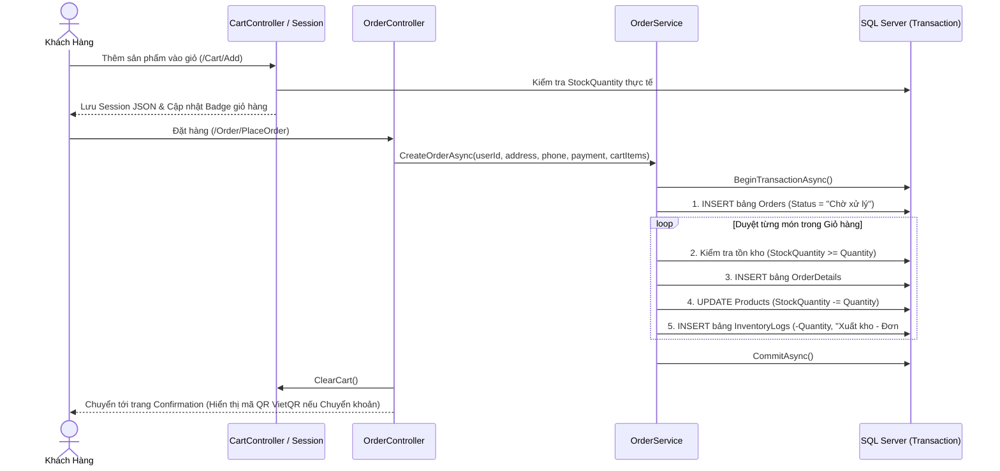

# BÁO CÁO ĐỒ ÁN 2: XÂY DỰNG HỆ THỐNG WEBSITE THƯƠNG MẠI ĐIỆN TỬ & QUẢN LÝ CỬA HÀNG CÁ CẢNH – THỦY SINH (AQUARIUM STORE) TÍCH HỢP TRỢ LÝ TƯ VẤN AI

---

## 1. THÔNG TIN TỔNG QUAN ĐỀ TÀI

| Hạng mục | Nội dung chi tiết |
| :--- | :--- |
| **Tên đề tài** | Xây dựng Website Bán Cá Cảnh, Cây Thủy Sinh & Thiết Bị Hồ Cá (**Aquarium Store**) tích hợp Quản lý Kho và Trợ lý Tư vấn AI (**AquaBot AI**) |
| **Nền tảng & Ngôn ngữ** | C# 13 / .NET 10.0 (`net10.0`) — Mô hình **ASP.NET Core MVC** |
| **Cơ sở dữ liệu & ORM** | Microsoft SQL Server (`AquariumStoreDb`) & **Entity Framework Core 10.0.13** (Code-First Migrations + SQL Script) |
| **Kiến trúc phần mềm** | Kiến trúc 3 tầng (**Presentation Layer** – **Business Logic / Service Layer** – **Data Access Layer**) kết hợp **Dependency Injection (DI)** |
| **Cơ chế Bảo mật** | **Cookie Authentication**, Phân quyền theo vai trò (**Role-Based Authorization**: `Admin`, `Staff`, `Customer`), Băm mật khẩu **SHA-256 Base64**, Chống giả mạo yêu cầu **CSRF (`[ValidateAntiForgeryToken]`)** |
| **Giao diện (Frontend)** | Razor Views (`.cshtml`), **Bootstrap 5.3**, Bootstrap Icons, **Chart.js** (Biểu đồ thống kê), **VietQR API** (Tạo mã QR chuyển khoản tự động), **Phòng Studio Xoay 360° 3D**, **AI Canvas Tự động Tách Nền Trắng**, **Hiệu ứng HOT Lửa Rực Cháy**, **AquaBot AI Widget** |
| **Tập tin CSDL đính kèm** | [`AquariumStoreDb.sql`](file:///c:/AquariumStore/AquariumStoreDb.sql) |
| **Tập tin Solution** | [`AquariumStore.sln`](file:///c:/AquariumStore/AquariumStore.sln) / [`AquariumStore.slnx`](file:///c:/AquariumStore/AquariumStore.slnx) |

---

## 2. KIẾN TRÚC HỆ THỐNG & CẤU TRÚC THƯ MỤC

### 2.1. Sơ đồ Kiến trúc 3 Tầng (3-Layer Architecture)



### 2.2. Cấu trúc Thư mục Mã nguồn (`c:\AquariumStore`)

```text
AquariumStore/
├── AquariumStore.sln                  # Tập tin Solution chuẩn mở trên Visual Studio 2022 / 2026
├── AquariumStore.slnx                 # Tập tin Solution XML mới của Visual Studio 2026
├── AquariumStore.csproj               # Cấu hình dự án .NET 10.0 & các gói NuGet EF Core
├── AquariumStoreDb.sql                # Kịch bản SQL tạo CSDL, 7 bảng, ràng buộc và dữ liệu mẫu
├── BAO_CAO_DO_AN_2.md                 # Tài liệu thuyết minh báo cáo Đồ Án 2
├── Program.cs                         # Điểm khởi đầu ứng dụng: DI, Middleware, Auto-Port Free (5080)
├── appsettings.json                   # Cấu hình chuỗi kết nối SQL Server (DefaultConnection)
│
├── Models/                            # 7 Lớp thực thể ánh xạ 7 bảng CSDL
│   ├── Role.cs                        # Thực thể Vai trò (Admin, Staff, Customer)
│   ├── User.cs                        # Thực thể Người dùng
│   ├── Category.cs                    # Thực thể Danh mục sản phẩm
│   ├── Product.cs                     # Thực thể Sản phẩm cá cảnh, thủy sinh, thiết bị
│   ├── Order.cs                       # Thực thể Đơn hàng
│   ├── OrderDetail.cs                 # Thực thể Chi tiết đơn hàng
│   └── InventoryLog.cs                # Thực thể Nhật ký biến động kho (Nhập/Xuất/Hoàn kho)
│
├── ViewModels/                        # Các lớp truyền tải dữ liệu (DTO / ViewModel)
│   ├── LoginViewModel.cs              # Form đăng nhập
│   ├── RegisterViewModel.cs           # Form đăng ký tài khoản
│   ├── ProfileViewModel.cs            # Form cập nhật hồ sơ cá nhân & đổi mật khẩu
│   ├── CartItemViewModel.cs           # Mục sản phẩm trong giỏ hàng Session
│   ├── CheckoutViewModel.cs           # Form đặt hàng & thanh toán
│   ├── ProductViewModel.cs            # Form thêm/sửa sản phẩm kèm tải ảnh (IFormFile)
│   ├── InventoryImportViewModel.cs    # Form lập phiếu nhập kho
│   ├── DashboardViewModel.cs          # Tổng hợp số liệu thống kê & biểu đồ Admin
│   └── AiChatViewModels.cs            # Cấu trúc bản tin hỏi/đáp của Trợ lý AI AquaBot
│
├── Data/                              # Tầng Truy cập dữ liệu (Data Access Layer)
│   ├── ApplicationDbContext.cs        # Cấu hình EF Core Fluent API, Index, Cascade & Seed gốc
│   └── DbSeeder.cs                    # Tự động Migrate và bổ sung tài khoản, sản phẩm, đơn hàng mẫu
│
├── Services/                          # Tầng Nghiệp vụ (Business Logic Layer)
│   ├── Interfaces/                    # 7 Giao diện dịch vụ (Loose Coupling)
│   ├── ProductService.cs              # Nghiệp vụ truy vấn, lọc, tìm kiếm, xóa mềm sản phẩm
│   ├── CategoryService.cs             # Nghiệp vụ quản lý danh mục
│   ├── OrderService.cs                # Nghiệp vụ đặt hàng Transaction, trừ kho, hủy đơn hoàn kho, thống kê
│   ├── InventoryService.cs            # Nghiệp vụ nhập hàng và ghi nhật ký tồn kho
│   ├── UserService.cs                 # Nghiệp vụ xác thực SHA256, đăng ký, hồ sơ, khóa tài khoản
│   ├── CartService.cs                 # Nghiệp vụ giỏ hàng lưu trữ JSON trong Session
│   └── AiChatService.cs               # Trí tuệ nhân tạo AquaBot AI tư vấn & tra cứu CSDL trực tiếp
│
├── Controllers/                       # Tầng Điều khiển (12 Controllers)
│   ├── HomeController.cs              # Trang chủ, Cẩm nang Thủy sinh (/Home/Guide), Chính sách (/Home/Policy)
│   ├── ProductController.cs           # Danh sách sản phẩm, lọc đa tiêu chí, sắp xếp, chi tiết
│   ├── CartController.cs              # Giỏ hàng kiểm tra tồn kho thực tế
│   ├── OrderController.cs             # Thanh toán, mã QR VietQR, lịch sử mua, tự hủy đơn chờ duyệt
│   ├── AccountController.cs           # Đăng nhập, đăng ký, đăng xuất, hồ sơ cá nhân
│   ├── ChatController.cs              # API Endpoint (/Chat/Ask) phục vụ khung chat AI
│   └── Admin/                         # Phân hệ Quản trị (Yêu cầu Role Admin hoặc Staff)
│       ├── DashboardController.cs
│       ├── ProductManagementController.cs
│       ├── CategoryManagementController.cs
│       ├── OrderManagementController.cs
│       ├── InventoryController.cs
│       └── UserManagementController.cs
│
├── Views/                             # Hệ thống giao diện Razor Views (.cshtml)
│   ├── Shared/                        # _Layout.cshtml (Khách hàng + Footer chuẩn + AI Chat), _AdminLayout.cshtml
│   ├── Home/                          # Index.cshtml, Guide.cshtml, Policy.cshtml (11 chính sách & hướng dẫn)
│   ├── Product/                       # Index.cshtml, Details.cshtml
│   ├── Cart/                          # Index.cshtml
│   ├── Order/                         # Checkout.cshtml, Confirmation.cshtml (VietQR), History.cshtml, Details.cshtml
│   ├── Account/                       # Login.cshtml, Register.cshtml, Profile.cshtml, AccessDenied.cshtml
│   └── Admin/                         # Giao diện quản trị Dashboard, Sản phẩm, Danh mục, Đơn hàng, Kho, User
│
└── wwwroot/                           # Tài nguyên tĩnh (CSS, JS, Hình ảnh sản phẩm)
    ├── css/site.css                   # Thiết kế giao diện chủ đề Đại dương & Thủy sinh hiện đại
    ├── js/site.js                     # Xử lý tương tác UI, Badge giỏ hàng và Khung chat AquaBot AI
    └── images/products/               # Thư mục lưu trữ hình ảnh sản phẩm
```

---

## 3. THIẾT KẾ CƠ SỞ DỮ LIỆU (DATABASE DESIGN & ERD)

### 3.1. Sơ đồ Quan hệ Thực thể (Entity-Relationship Diagram - 7 Bảng)



### 3.2. Điểm nhấn Kỹ thuật trong Thiết kế CSDL ([`ApplicationDbContext.cs`](file:///c:/AquariumStore/Data/ApplicationDbContext.cs))
1. **Xử lý triệt để lỗi *Multiple Cascade Paths* trên SQL Server:**
   - Trong hệ thống có đường dẫn vòng giữa `Users -> Orders -> OrderDetails <- Products <- InventoryLogs <- Users`. Nếu để mặc định `Cascade Delete`, SQL Server sẽ báo lỗi khi tạo bảng.
   - Hệ thống cấu hình `OnDelete(DeleteBehavior.Restrict)` cho các khóa ngoại chính và chỉ bật `OnDelete(DeleteBehavior.Cascade)` từ `Orders -> OrderDetails`, kết hợp cơ chế **Xóa mềm (`IsActive = false`)** cho `Users`, `Categories`, `Products` để bảo toàn 100% lịch sử hóa đơn và sổ kho.
2. **Định kiểu tiền tệ chính xác:** Tất cả các cột giá tiền (`Product.Price`, `Order.TotalAmount`, `OrderDetail.UnitPrice`) đều được định kiểu tường minh `decimal(18,2)`.
3. **Đảm bảo toàn vẹn dữ liệu bằng Giao dịch (`Database Transaction`):**
   - Khi khách đặt hàng ([`OrderService.CreateOrderAsync`](file:///c:/AquariumStore/Services/OrderService.cs#L64-L132)) hoặc khi hủy đơn hoàn kho ([`OrderService.UpdateStatusAsync`](file:///c:/AquariumStore/Services/OrderService.cs#L137-L182)) hoặc nhập kho ([`InventoryService.ImportStockAsync`](file:///c:/AquariumStore/Services/InventoryService.cs#L42-L76)), toàn bộ thao tác trên các bảng `Orders`, `OrderDetails`, `Products`, `InventoryLogs` được bọc trong `BeginTransactionAsync()` / `CommitAsync()` / `RollbackAsync()`.

---

## 4. PHÂN TÍCH CÁC LUỒNG NGHIỆP VỤ CHÍNH

### 4.1. Luồng Đặt Hàng, Trừ Kho Tự Động & Hoàn Kho Khi Hủy Đơn



### 4.2. Chi tiết các Phân hệ Chức năng đã Xây dựng

#### A. Phân hệ Khách hàng (Customer Storefront)
1. **Trang chủ hiện đại ([`Views/Home/Index.cshtml`](file:///c:/AquariumStore/Views/Home/Index.cshtml)):**
   - Banner Carousel 3 chủ đề, thanh thông báo ưu đãi đầu trang, 4 thẻ cam kết dịch vụ (Bảo hành cá sống DOA 100%, Đóng gói Oxy 3 lớp, Giao hỏa tốc 2h, Tư vấn trọn đời).
   - Danh mục sản phẩm kèm bộ đếm số lượng mặt hàng thực tế, khu vực **Gợi ý cho Người Mới Bắt Đầu** và **Sản phẩm nổi bật**.
2. **Tìm kiếm & Bộ lọc Đa tiêu chí ([`ProductController.cs`](file:///c:/AquariumStore/Controllers/ProductController.cs)):**
   - Kết hợp đồng thời: Lọc theo Danh mục + Tìm kiếm từ khóa + Khoảng giá (`minPrice` – `maxPrice`) + Chỉ hiện hàng còn trong kho (`inStockOnly`) + Sắp xếp (Mới nhất, Giá tăng/giảm dần, Tên A–Z).
3. **Giỏ hàng thông minh & Thanh toán VietQR ([`CartController.cs`](file:///c:/AquariumStore/Controllers/CartController.cs), [`OrderController.cs`](file:///c:/AquariumStore/Controllers/OrderController.cs)):**
   - Tự động điền sẵn Địa chỉ và Số điện thoại từ hồ sơ người dùng khi Checkout.
   - Hỗ trợ thanh toán **COD** hoặc **Chuyển khoản ngân hàng** (tự động sinh mã **VietQR** điền sẵn đúng số tiền và nội dung `AQST DH#MãĐơn` trên trang xác nhận và chi tiết đơn).
   - Khách hàng có thể **tự hủy đơn hàng** khi đơn đang ở trạng thái `"Chờ xử lý"`, hệ thống tự động cộng trả lại số lượng vào kho và ghi `InventoryLog`.
4. **Hồ sơ cá nhân & Đổi mật khẩu ([`AccountController.cs`](file:///c:/AquariumStore/Controllers/AccountController.cs)):**
   - Cho phép khách hàng cập nhật Họ tên, Số điện thoại, Địa chỉ nhận hàng mặc định và Đổi mật khẩu có xác minh mật khẩu cũ.
5. **Cẩm nang Thủy sinh & 11 Trang Hướng dẫn / Chính sách ([`Views/Home/Guide.cshtml`](file:///c:/AquariumStore/Views/Home/Guide.cshtml), [`Views/Home/Policy.cshtml`](file:///c:/AquariumStore/Views/Home/Policy.cshtml)):**
   - Tích hợp đầy đủ khu vực **HƯỚNG DẪN** (Hướng dẫn mua hàng, Hướng dẫn thanh toán, Hướng dẫn giao nhận, Điều khoản dịch vụ, Mua hàng miễn phí vận chuyển trên Shopee) và **CHÍNH SÁCH** (Chính sách & Quy định chung, Bảo mật thông tin, Vận chuyển giao nhận, Đổi/trả hàng & hoàn tiền 48h, Quy định thanh toán, Chính sách kiểm hàng) cùng huy hiệu **VISA, MasterCard, PayPal, JCB** và **ĐÃ THÔNG BÁO BỘ CÔNG THƯƠNG**.
6. **Chuyên trang Landing Page Tép Cảnh, Cầu Rêu Marimo & Cần Câu Carbon ([`Views/Home/Landing.cshtml`](file:///c:/AquariumStore/Views/Home/Landing.cshtml)):**
   - Thiết kế chuyên biệt cho dòng sản phẩm **Tép Màu Neocaridina**, **Tép Ong Caridina (Red Bee PRL, Galaxy Pinto)**, **Cầu Rêu Marimo Nhật Bản** và **Cần Câu Tôm Tép / Cần Lure Carbon**.
   - Tích hợp hiệu ứng bọt khí thủy sinh 3D (`water-bubble`), bảng tra cứu chuẩn thông số nước (`pH`, `TDS`, `GH`, nhiệt độ) và công cụ tương tác **Chọn nhanh 3 Combo theo phong cách chơi**.
7. **Phòng Studio Xoay 360° 3D & Soi Chi Tiết Sản Phẩm ([`Views/Shared/_Layout.cshtml`](file:///c:/AquariumStore/Views/Shared/_Layout.cshtml), [`wwwroot/js/site.js`](file:///c:/AquariumStore/wwwroot/js/site.js)):**
   - Khi bấm vào bất kỳ ảnh sản phẩm hoặc cần câu nào trên toàn website, hệ thống mở cửa sổ **360° 3D Studio** cho phép nắm kéo chuột/cảm ứng xoay 0°–360°, bật/tắt tự xoay, phóng đại `1x` / `1.6x` / `2.2x` và bấm 4 nút **Hotspot thông minh** (tự động đổi tiêu đề & mô tả kỹ thuật theo từng loại sản phẩm: Cần câu, Tép/Cá cảnh, Cây thủy sinh/Cầu rêu, Thiết bị).
8. **Công nghệ AI Tách Nền Trắng Tự Động bằng HTML5 Canvas (`processSmartCutout` & `initAutoBackgroundRemoval` trong [`wwwroot/js/site.js`](file:///c:/AquariumStore/wwwroot/js/site.js)):**
   - Tự động phát hiện và xóa bỏ hoàn toàn nền trắng/sáng khó chịu trên ảnh sản phẩm bằng thuật toán loang **Flood-Fill (BFS)** từ 4 cạnh viền kết hợp xóa lỗ trắng khép kín, làm mềm viền khử răng cưa (**Alpha Feathering**) và tự động cắt căn giữa theo khung bao (**Bounding Box Auto-Centering**) với khoảng thở 7% cân đối cùng bóng đổ 3D ôm sát vật thể.
9. **Hiệu Ứng HOT Lửa Rực Cháy cho Sản Phẩm Bán Chạy Nhất ([`Services/ProductService.cs`](file:///c:/AquariumStore/Services/ProductService.cs), [`wwwroot/css/site.css`](file:///c:/AquariumStore/wwwroot/css/site.css)):**
   - Phương thức `GetBestSellingCountsAsync` tự động thống kê số lượng bán thực tế từ bảng `OrderDetails`. Các sản phẩm Top Bán Chạy tự động hiển thị khung viền lửa rực cháy (`.hot-fire-card`), dải ngọn lửa bốc lên dưới đáy ảnh (`.fire-flames-bar`) và huy hiệu `🔥 HOT BÁN CHẠY • Đã bán X+`.

#### B. Phân hệ Trợ lý Tư vấn AI (`AquaBot AI` — [`AiChatService.cs`](file:///c:/AquariumStore/Services/AiChatService.cs))
- Khung chat nổi góc phải màn hình hoạt động 24/7, trả lời **trực tiếp vào trọng tâm** mọi câu hỏi của khách hàng (hiểu cả tiếng Việt có dấu và không dấu):
  - **Tư vấn kỹ thuật từng loài cá & cây thủy sinh:** Báo giá bán và tồn kho thực tế từ SQL Server kèm thông số nhiệt độ, pH, tập tính ghép đàn, cách xử lý nước đục, rêu hại, nấm trắng.
  - **Tính toán mật độ nuôi cá theo kích thước bể:** Áp dụng công thức chuẩn thủy sinh cho bể 30cm, 40–50cm, 60cm.
  - **Tư vấn theo ngân sách:** Ví dụ khách hỏi *"dưới 100k mua được gì"*, bot tự động lọc các sản phẩm có giá $\le 100.000\text{ ₫}$ đang còn hàng và hiển thị thẻ sản phẩm kèm nút **Xem / Mua** ngay trong khung chat.
  - **Tra cứu đơn hàng trực tiếp trong CSDL:** Khách nhắn *"Kiểm tra đơn hàng #1"*, bot truy vấn bảng `Orders` và trả về trạng thái, ngày đặt, danh sách món và tổng tiền ngay lập tức.

#### C. Phân hệ Quản trị & Nhân viên (`Admin` / `Staff`)
1. **Bảng điều khiển Thống kê ([`DashboardController.cs`](file:///c:/AquariumStore/Controllers/Admin/DashboardController.cs)):**
   - 4 thẻ KPI tổng quan (Tổng doanh thu thực tế, Đơn hàng chờ xử lý, Sản phẩm đang bán, Tổng khách hàng).
   - **Biểu đồ cột & đường (Chart.js):** Doanh thu theo từng tháng trong 12 tháng gần nhất.
   - **Biểu đồ tròn (Doughnut Chart):** Tỷ lệ đơn hàng theo 5 trạng thái.
   - **Bảng cảnh báo tồn kho thấp:** Liệt kê các sản phẩm có `StockQuantity <= 5` kèm nút chuyển nhanh sang lập phiếu nhập kho.
2. **Quản lý Sản phẩm & Danh mục ([`ProductManagementController.cs`](file:///c:/AquariumStore/Controllers/Admin/ProductManagementController.cs), [`CategoryManagementController.cs`](file:///c:/AquariumStore/Controllers/Admin/CategoryManagementController.cs)):**
   - Thêm mới, chỉnh sửa, tải ảnh sản phẩm (`IFormFile` lưu tên GUID duy nhất vào `wwwroot/images/products/`), ẩn/hiện sản phẩm và danh mục.
3. **Quản lý Đơn hàng & Kho hàng ([`OrderManagementController.cs`](file:///c:/AquariumStore/Controllers/Admin/OrderManagementController.cs), [`InventoryController.cs`](file:///c:/AquariumStore/Controllers/Admin/InventoryController.cs)):**
   - Lọc đơn hàng theo trạng thái, duyệt đơn, hoàn kho tự động khi hủy đơn, lập phiếu nhập hàng mới và tra cứu toàn bộ lịch sử biến động kho (`InventoryLogs`).
4. **Quản lý Người dùng ([`UserManagementController.cs`](file:///c:/AquariumStore/Controllers/Admin/UserManagementController.cs)):**
   - Xem danh sách tài khoản, phân quyền vai trò, khóa/mở khóa tài khoản (có cơ chế bảo vệ không cho Admin tự khóa tài khoản đang đăng nhập).

---

## 5. DANH SÁCH TÀI KHOẢN KIỂM THỬ & HƯỚNG DẪN CHẠY ĐỒ ÁN

### 5.1. Tài khoản Mẫu (Được khởi tạo tự động khi chạy ứng dụng hoặc chạy file SQL)

| Vai trò (Role) | Tên đăng nhập (`Username`) | Mật khẩu (`Password`) | Quyền hạn trong hệ thống |
| :--- | :--- | :--- | :--- |
| **Quản trị viên (`Admin`)** | `admin` | `Admin@123` | Toàn quyền hệ thống: Dashboard, Sản phẩm, Danh mục, Đơn hàng, Kho hàng, Quản lý Người dùng |
| **Nhân viên (`Staff`)** | `staff` | `Staff@123` | Quản trị vận hành: Xem Dashboard, Quản lý Sản phẩm, Xử lý Đơn hàng, Nhập kho |
| **Khách hàng 1 (`Customer`)** | `customer` | `Customer@123` | Mua sắm, Giỏ hàng, Đặt hàng, Xem lịch sử đơn, Hủy đơn chờ duyệt, Hồ sơ cá nhân |
| **Khách hàng 2 (`Customer`)** | `khachhang2` | `Customer@123` | Tài khoản khách hàng mẫu có sẵn lịch sử đơn hàng |
| **Khách hàng 3 (`Customer`)** | `khachhang3` | `Customer@123` | Tài khoản khách hàng mẫu có sẵn đơn hàng đang chờ xử lý |

### 5.2. Hướng dẫn Chạy Đồ án trên Visual Studio 2026 & SQL Server

1. **Cách 1 — Chạy trực tiếp trên Visual Studio 2026 (Tự động 100%):**
   - Mở tệp [`AquariumStore.sln`](file:///c:/AquariumStore/AquariumStore.sln) hoặc [`AquariumStore.slnx`](file:///c:/AquariumStore/AquariumStore.slnx) bằng **Visual Studio 2026**.
   - Nhấn nút **Run `http` (phím F5 hoặc Ctrl + F5)**.
   - Ứng dụng sẽ tự động kết nối SQL Server LocalDB, tự động chạy Migration tạo đủ 7 bảng, nạp toàn bộ dữ liệu mẫu (`DbSeeder`) và mở trình duyệt tại địa chỉ: **`http://localhost:5080`**.

2. **Cách 2 — Khởi tạo CSDL thủ công trên SQL Server Management Studio (SSMS):**
   - Mở **SQL Server Management Studio (SSMS)** và mở tệp [`AquariumStoreDb.sql`](file:///c:/AquariumStore/AquariumStoreDb.sql).
   - Nhấn **Execute (F5)** để tạo cơ sở dữ liệu `AquariumStoreDb`, tạo 7 bảng, các ràng buộc khóa ngoại, chỉ mục và nạp đầy đủ dữ liệu mẫu.
   - Nếu dùng tên Server khác `(localdb)\MSSQLLocalDB` (ví dụ `.\SQLEXPRESS`), chỉnh lại `DefaultConnection` trong [`appsettings.json`](file:///c:/AquariumStore/appsettings.json#L9-L11) rồi nhấn **F5** trong Visual Studio.

---

## 6. HƯỚNG DẪN ĐƯA DỰ ÁN LÊN GITHUB (UPLOAD / PUSH TO GITHUB)

Dự án đã được cấu hình sẵn tập tin [`.gitignore`](file:///c:/AquariumStore/.gitignore) chuẩn `.NET 10` (tự động loại bỏ các thư mục biên dịch tạm `bin/`, `obj/`, `.vs/` nhưng giữ lại đầy đủ 100% mã nguồn, file [`AquariumStoreDb.sql`](file:///c:/AquariumStore/AquariumStoreDb.sql), báo cáo `.md` và toàn bộ ảnh sản phẩm trong `wwwroot/images/products/`).

### 6.1. Cách 1 — Đẩy dự án lên GitHub bằng lệnh Git (Terminal / PowerShell)

1. **Bước 1:** Truy cập [https://github.com/new](https://github.com/new), đăng nhập tài khoản GitHub và tạo một Repository mới (ví dụ đặt tên là `AquariumStore-DoAn2`), **không** tích chọn *Add a README file* rồi bấm **Create repository**.
2. **Bước 2:** Mở **PowerShell** hoặc **Terminal** ngay tại thư mục dự án `c:\AquariumStore` và chạy lần lượt các lệnh sau:

```powershell
# 1. Di chuyển vào thư mục gốc của dự án
cd C:\AquariumStore

# 2. Khởi tạo kho lưu trữ Git cục bộ (Local Repository)
git init

# 3. Thêm toàn bộ mã nguồn, file SQL, báo cáo .md và hình ảnh sản phẩm (theo chuẩn .gitignore)
git add .

# 4. Đóng gói phiên bản đầu tiên (Commit)
git commit -m "Hoan thanh Do An 2: Website Aquarium Store (.NET 10 MVC, Landing Page, 360 Studio AI Cutout, AquaBot AI)"

# 5. Đổi tên nhánh chính thành main
git branch -M main

# 6. Liên kết với Repository trên GitHub của bạn (thay <TEN_TAI_KHOAN_GITHUB> bằng tên GitHub của bạn)
git remote add origin https://github.com/<TEN_TAI_KHOAN_GITHUB>/AquariumStore-DoAn2.git

# 7. Đẩy toàn bộ dự án lên GitHub
git push -u origin main
```

3. **Khi cập nhật thêm code mới sau này**, chỉ cần chạy 3 lệnh ngắn gọn:
```powershell
git add .
git commit -m "Cap nhat tinh nang moi"
git push
```

### 6.2. Cách 2 — Đẩy dự án lên GitHub trực tiếp bằng giao diện Visual Studio 2026 (Không cần gõ lệnh)

1. Mở dự án [`AquariumStore.sln`](file:///c:/AquariumStore/AquariumStore.sln) trên **Visual Studio 2026**.
2. Trên thanh menu trên cùng, chọn **Git** $\rightarrow$ **Create Git Repository...**
3. Trong cửa sổ hiện ra:
   - Mục **Account**: Đăng nhập tài khoản **GitHub** của bạn.
   - Mục **Repository name**: Nhập `AquariumStore-DoAn2`.
   - Bỏ tích *Private repository* (nếu muốn để **Public** gửi link cho giảng viên chấm điểm).
4. Nhấn nút **Create and Push** — Visual Studio 2026 sẽ tự động tạo kho chứa trên GitHub và tải toàn bộ dự án lên chỉ trong vài giây!


